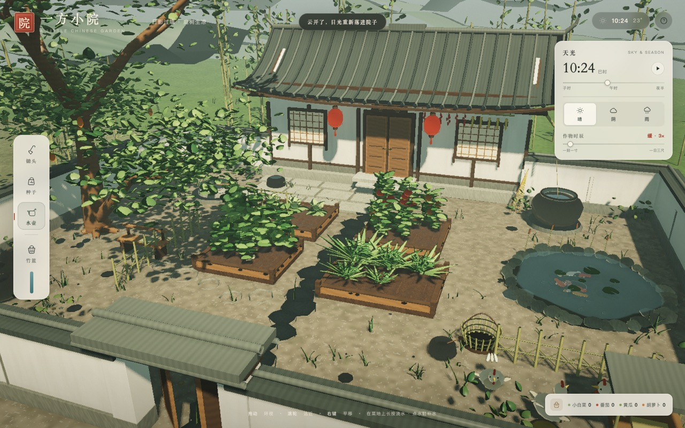

# 一方小院 · A Little Chinese Garden

**在线体验：** https://kidofjealous.github.io/a-little-chinese-garden/



## 原始提示词

```text
# 一方小院：可交互中式庭院与菜园 3D 沙盒

请使用原生 WebGPU + WGSL 开发一个完整、可运行、可交互的 3D 网页沙盒，全部代码放入单个 HTML 文件中。

项目名称：**一方小院 · A Little Chinese Garden**

## 一、场景设计

创建一座安静、精致、富有生活气息的传统江南农家小院。

整体采用写实与轻度风格化结合的美术风格，注重自然光照、材质细节、空间层次和温暖的生活氛围。

场景包含：

- 一间白墙黛瓦的中式小屋，拥有木门、木窗、飞檐和瓦片细节
- 围合庭院的矮墙、木栅栏与竹篱笆
- 不规则铺设的青石板小路，石缝中长有少量杂草和青苔
- 四块不同大小的菜畦，具有真实的垄沟、土壤颗粒和微小高低差
- 小型竹制黄瓜架，悬挂的藤蔓、叶片与果实
- 庭院角落的老树、石磨、木凳、竹篮、陶罐和储水缸
- 屋檐下晾晒的辣椒、玉米等生活细节
- 远处朦胧的山峦与竹林，营造庭院之外仍有世界的感觉

建筑、植物、道路和院墙必须具有真实的三维几何结构，不能用平面背景图片冒充场景。

## 二、可交互菜园

菜地是整个项目的核心，不能只是装饰。

实现至少四种作物：

1. 小白菜：叶片从幼苗逐渐向外展开
2. 番茄：植株长高、开花、结出青果，果实逐渐变红
3. 黄瓜：藤蔓攀爬竹架，叶片和果实沿藤蔓生长
4. 胡萝卜：地上长出叶簇，地下根部逐渐膨大，收获时完整拔出

每种作物至少拥有播种、发芽、生长、成熟四个可观察阶段。

植物生长必须由程序状态驱动，而不是简单显示或隐藏预设模型。不同阶段要通过几何尺寸、叶片数量、颜色、姿态和果实生成体现。

## 三、土壤与浇水系统

实现一个可交互的园艺系统。

玩家可以选择工具：

- 锄头：翻动指定地块，使平整土地形成可种植的土垄
- 种子：选择作物品种，在指定位置播种
- 水壶：倾斜水壶，连续浇水
- 篮子：点击成熟作物进行收获

水壶倾斜时应产生连续的水流或大量连续水滴，水滴受重力影响，与土壤发生碰撞。

土壤使用二维湿度网格记录局部含水量：

- 浇水位置首先变湿
- 水分向相邻网格扩散和渗透
- 湿土颜色加深，并产生适度的表面光泽
- 阳光与风会使土壤缓慢干燥
- 积水区域可以形成小水洼

作物生长速度受到土壤湿度、光照和生长时间影响。缺水时叶片逐渐下垂，浇水后可以恢复。

这些变化应当是持续且可观察的，不允许只播放一个与土壤状态无关的预设动画。

## 四、昼夜与天气模拟

实现可调整的时间和天气系统。

**昼夜变化**

- 太阳随时间移动，建筑、树木和植物阴影相应变化
- 清晨具有柔和的金色光照
- 正午光线明亮，阴影较短
- 黄昏出现暖橙色夕阳
- 夜晚庭院变暗，屋檐下的灯笼提供暖色照明

**天气变化**

提供晴天、阴天和雨天。

雨天时：

- 雨滴从天空落下
- 雨水落在瓦片和石板上产生细小飞溅
- 屋檐边缘出现滴水
- 石板逐渐变湿并具有反射高光
- 菜地含水量随着降雨增加
- 水缸中的水面缓慢上升

雨停后，积水逐渐消退，土壤逐渐变干。

## 五、植物与环境动态

庭院必须呈现自然的生命感。

- 微风吹过时，蔬菜叶片、树枝、竹叶发生不同幅度的摆动
- 藤蔓与较粗的枝条摆动较小，柔软叶片摆动较大
- 树叶阴影可以投射到墙面和地面
- 蝴蝶偶尔在菜地周围飞行
- 庭院中的小鸡可以随机散步、停下、啄食
- 玩家靠近小鸡时，小鸡会改变移动方向

动画尽量由时间、风场、状态机和简单物理规律驱动，避免所有物体以同样的频率机械摆动。

## 六、交互方式

提供自由旋转、平移和缩放的 3D 摄像机，初始使用略微俯视的庭院全景视角。

支持：

- 鼠标左键与场景对象交互
- 鼠标拖动旋转视角
- 滚轮缩放
- 点击菜地进行播种、翻土和收获
- 长按鼠标连续浇水
- 点击水缸给水壶补水
- 点击庭院物品查看对应的简单反馈

提供精致、简洁、不遮挡主要画面的 UI，包含工具栏、种子选择、天气切换、时间调节、生长速度控制及作物信息。

鼠标指向作物时，显示品种、生长阶段、成熟进度和当前土壤湿度。

## 七、渲染与技术要求

- 使用原生 WebGPU 和 WGSL 着色器
- 最终交付单个 HTML 文件
- 不依赖外部 3D 模型、贴图或 CDN
- 通过程序化几何与材质生成场景
- 使用真实的三维深度和相机透视
- 实现合理的光照、阴影、环境遮蔽和材质反应
- 尽可能采用实例化渲染处理大量叶片与草丛
- 对植物的生长和风动使用程序化变形
- 使用 delta time 更新动画，避免帧率改变影响模拟速度
- 保证场景对象可以被准确拾取和交互
- 合理控制 GPU 资源与绘制开销，优先保证稳定的实时运行

## 八、最终体验目标

打开页面后，用户应该看到一座完整、优美的江南小院。

用户能够走近菜地，翻土、播种、浇水，然后加速时间，看见植物从幼苗逐渐长成成熟蔬菜。

用户能够收获番茄，看着它们进入竹篮；能够切换到雨天，看着雨水沿屋檐滴落，土壤湿润，叶片在风中摇晃。

这个项目应当让用户感受到自己正在照料一座真实的小院，而不是观看一个静态的建筑模型。

**优先保证完整可运行、视觉质量、真实交互和状态连续性。**

不要输出伪代码、实现方案或静态效果图。请直接生成完整的可运行程序。所有已提供的 UI 控件必须具有真实功能，不允许存在仅用于展示的无效按钮。
```
